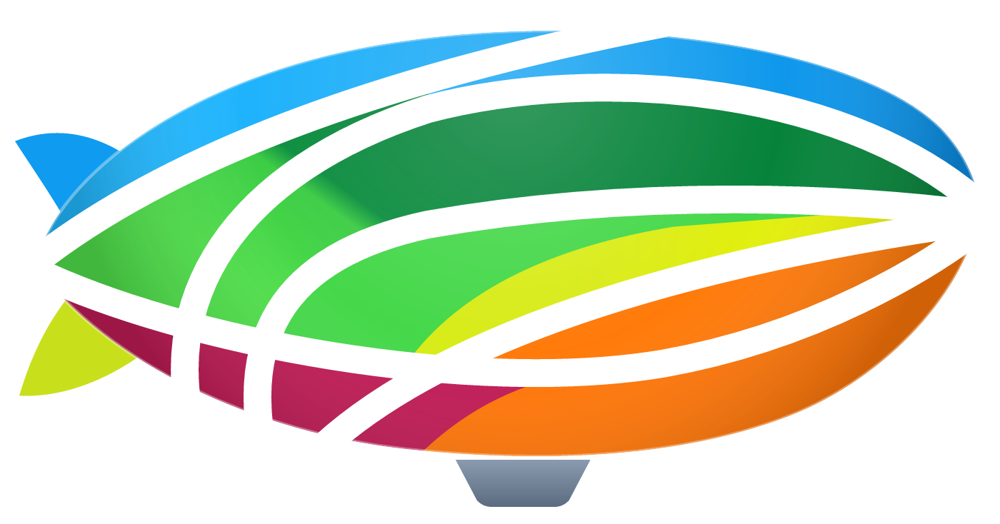

<p align="center">
  
</p>

<h1 align="center">AnyVector</h1>

<p align="center">
  <strong>Professional vector graphics for Windows, with the workspace CorelDRAW users already know.</strong>
</p>

<p align="center">
  <a href="https://github.com/toim22/AnyVector/releases/latest"></a>
  
  
  
</p>

<p align="center">
  <a href="https://github.com/toim22/AnyVector/releases/latest"><strong>Download AnyVector 0.4.1</strong></a>
  ·
  <a href="docs/RELEASE-NOTES-0.4.1.md">What's new</a>
  ·
  <a href="https://github.com/toim22/AnyVector/issues">Report a bug or share an idea</a>
</p>

---

## Why AnyVector

Learning a new drawing program takes weeks you don't have. AnyVector skips that: its menus, toolbars, tools, property
bars, dockers and dialogs follow the CorelDRAW 2026 layout item by item, with the same captions, shortcuts and order.
Your muscle memory works on day one.

- **Familiar from the first click.** All 12 menus, 60 tools with their property bars, the toolbox with 15 flyouts,
  right-click menus and dockers are where you expect them.
- **Opens your work.** Reads and writes CorelDRAW-compatible `.cdr` files and `.cdrt` templates, plus SVG, PDF and
  the common bitmap formats.
- **Fast and lightweight.** A single native Windows program written in Rust. No account, no cloud sign-in, no
  subscription screens.
- **Your language.** The whole interface is available in the 15 languages CorelDRAW offers: English, Chinese
  (Simplified and Traditional), Czech, Dutch, French, German, Italian, Japanese, Polish, Brazilian Portuguese,
  Russian, Spanish, Swedish and Turkish. You can switch languages instantly without restarting.
- **Always up to date.** AnyVector checks for new versions in the background and installs them when you close it,
  after asking you to save your drawings.

## Features

### Drawing and editing
- Pick, Free Transform and Shape tools, Freehand, Bézier, Pen, B-Spline, Polyline, 3-Point Curve, LiveSketch, Smart
  Drawing, Artistic Media and Painterly Brush.
- Rectangles, ellipses, polygons, stars and spirals, plus dimension and connector tools.
- Interactive effects: Blend, Contour, Distort, Drop Shadow, Envelope, Extrude and Transparency.
- Interactive Fill, Mesh Fill, Smart Fill and the eyedroppers.
- Symmetry and Perspective drawing modes.

### Text and tables
- Artistic and paragraph text with tabs, columns, bullets, numbering, drop caps, hyphenation and linked frames.
- Spell check, Grammatik, Thesaurus and QuickCorrect, using the Windows spell checker.
- Tables with cell selection, merging, splitting and row and column editing.

### Effects and bitmaps
- 120 bitmap effects that you can edit in the Properties docker and see live on the canvas.
- PowerTRACE, Remove Background, Image Adjustment Lab, Straighten Image, Resample and color mode conversion.

### Output
- Publish to PDF with PDF/X and PDF/A, passwords and permissions.
- Export for Office, Web and WordPress.
- Full print dialog with Print Preview, Prepress options and Print Merge.

### Workspace
- Workspaces for Default, Lite, Touch, Illustration, Page Layout and Adobe Illustrator users, plus your own.
- Every docker in Window ▸ Dockers, color palettes with a Palette Editor, multiple windows per drawing, and offline
  Help with a User Guide generated from the program itself.

## Install

1. Download `AnyVector-0.4.1-setup.exe` from the [latest release](https://github.com/toim22/AnyVector/releases/latest).
2. Run it. No administrator rights are needed, because AnyVector installs for your user by default. You can also
   choose to install it for all users.
3. Choose the language AnyVector should start in. You can change it later in
   Tools ▸ Options ▸ Global ▸ General.

The setup can add AnyVector to "Open with" for `.cdr` files and can open `.vct` and SVG files.

**Requirements:** Windows 10 or 11, 64-bit.

## Build from source

You need [Rust](https://rustup.rs) (stable) and, to build the installer, [Inno Setup](https://jrsoftware.org/isinfo.php) 6.7 or later.

```bash
cargo build --release
```

```bash
cargo test
```

The program is built to `target\release\anyvector.exe`. To package it, compile `installer\AnyVector.iss` with
Inno Setup (`ISCC.exe installer\AnyVector.iss`), which writes `dist\AnyVector-<version>-setup.exe`.

| Folder | What's inside |
| --- | --- |
| `crates/anyvector` | The Windows program: interface, tools, dialogs and dockers |
| `crates/vector-core` | Document model, geometry, styles, text layout and undo history |
| `crates/vector-render` | Rendering and bitmap effects |
| `crates/vector-io` | File formats: `.cdr`, `.vct`, SVG, PDF and bitmaps |
| `xtask` | Build helpers for brand assets, interface data and coverage reports |
| `installer` | The Inno Setup script and wizard images |
| `docs` | Architecture, status, coverage and release notes |

## Project status

AnyVector **0.4.1** opens drawings saved by every version of CorelDRAW, from CorelDRAW 1 to 2026, and Corel
clipart (see [the release notes](docs/RELEASE-NOTES-0.4.1.md)). See [docs/STATUS.md](docs/STATUS.md) for progress and
[docs/COVERAGE.md](docs/COVERAGE.md) for the item-by-item list of what is complete. Known limits:

- Licensed palette books (PANTONE, TRUMATCH and others) are not included.
- Workspaces exported from CorelDRAW (`.cdws`) can't be imported yet.
- Some dockers and dialogs show controls that aren't active yet.

## Feedback

Use **Help ▸ Submit Ideas and Feedback** or **Help ▸ Report a Bug** inside AnyVector, or open an
[issue](https://github.com/toim22/AnyVector/issues).

## License

Copyright © AnyVector Team. All rights reserved. AnyVector is proprietary software. The open-source components it
includes are listed with their licenses in Help ▸ About AnyVector ▸ Legal Notices.

<sub>CorelDRAW, Grammatik, PowerTRACE and PANTONE are trademarks of their respective owners. AnyVector is an independent
product and isn't affiliated with or endorsed by them.</sub>
